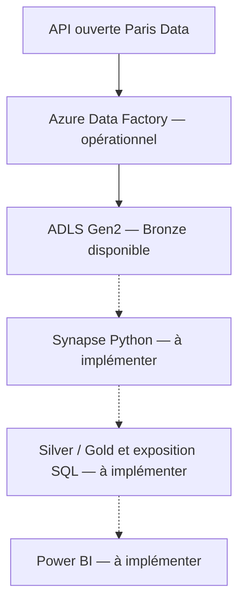

# Vélib Data Platform — Azure

Projet SUPINFO **5CLOU** · Équipe : **Chifa Chouchane, Cyrine Chammem et Nidhal Derbali**.

Une plateforme destinée à collecter les disponibilités Vélib depuis une API ouverte, conserver leur historique dans Azure, transformer les données avec **Python dans Azure Synapse Analytics**, puis présenter les résultats dans **Power BI**.

> **État au 28 octobre 2026 :** ingestion Azure Data Factory opérationnelle et testée, données Bronze disponibles, documentation et première base Terraform intégrées à `main`. Synapse, les couches Silver/Gold et Power BI restent à réaliser. La plateforme complète n’est pas encore livrée.

## Avancement selon l’énoncé

**Fonctionnel** : testé. **Partiel** : des éléments restent à terminer. **À faire** : aucune réalisation confirmée dans cette version du dépôt.

| Exigence | État vérifié | Responsable | Pour terminer |
|---|---|---|---|
| Source ouverte | Fonctionnel : API Vélib Paris Data | Chifa | Compléter les conditions de réutilisation et la documentation de fraîcheur |
| Ingestion Data Factory — 6 points | Fonctionnel : pagination, stockage et programmation | Chifa | Automatiser la complétude, tester les échecs et intégrer Synapse |
| Traitement Synapse/Python — 6 points | À faire | Cyrine ; infrastructure avec Nidhal | Workspace, calcul, transformations, qualité et sorties analytiques |
| Visualisation Power BI — 4 points | À faire | Nidhal ; données avec Cyrine | Modèle, mesures, interactions et actualisation vérifiée |
| Code et dépôt — 2 points | Partiel : séparation ADF/Terraform/docs, commits et PR | Tous ; coordination Chifa | Contrôles automatisés, documentation finale et revues |
| Bonus Terraform — 2 points | Partiel : cinq ressources existantes importées, plan sans changement | Base Chifa ; suite Nidhal | Synapse, composants BI automatisables, état partagé et reproductibilité |
| Introduction — 2 points ; aisance orale — 2 points | À préparer | Tous | Support et répétitions chronométrées |
| Questions/réponses — 6 points | À préparer | Tous | Maîtriser la chaîne et justifier les choix |
| ZIP et démonstration Azure | À préparer | Tous ; coordination Chifa | Version finale, archive et démonstration complète |

Les points reprennent le barème fourni ; aucune note n’est considérée comme acquise.

## Architecture



Les liens en pointillés représentent les intégrations restantes.

**Périmètre :** l’implémentation actuelle utilise Azure Data Factory, ADLS Gen2 et le fournisseur Terraform `hashicorp/azurerm`. La suite prévue utilise Azure Synapse Analytics et Power BI, conformément aux étapes Azure détaillées dans l’énoncé. Celui-ci emploie aussi le nom Microsoft Fabric : aucun workspace Fabric ni stockage OneLake n’est présenté ici comme déjà déployé. Cette distinction doit être explicitée lors de la présentation du périmètre retenu.

**Temporalité :** collecte par lots toutes les **10 minutes**, durant environ **5 minutes** pendant les essais. Il ne s’agit pas d’un flux événementiel continu. La latence jusqu’au dashboard dépendra également du traitement et de l’actualisation BI, encore non mesurés. La date source `duedate` diffère de la date de collecte ; une collecte paginée ne constitue pas un instantané atomique.

## Équipe : contributions et responsabilités

### Chifa — ingestion, coordination et première base Terraform

**Réalisé et vérifié :**

- Choix de la source Vélib et analyse des réponses JSON.
- Création du groupe de ressources, du stockage ADLS Gen2 et de Data Factory.
- Configuration des services liés REST/ADLS et de l’identité managée ADF pour le stockage.
- Datasets paramétrés, pipeline de test et pipeline paginé principal.
- Historisation par lot, contrôle du total annoncé, nouvelles tentatives et manifeste de fin de copie.
- Intégration GitHub, fusion de l’ingestion dans `main` et publication Azure.
- Programmation toutes les 10 minutes : quatre exécutions réussies figurent dans l’export de supervision.
- Contrôle hors pipeline d’un ZIP de 16 pages, contenant 1 520 stations distinctes.
- Guide d’ingestion, captures et export CSV présents dans le dépôt.
- Base Terraform : cinq ressources existantes importées, validation réussie et plan `No changes`.
- Intégration du code Terraform et de son guide dans `main`.
- Préparation des attributions Azure pour Cyrine et Nidhal ; accès effectifs à vérifier avec chacun.

**À terminer :**

1. Tester et documenter le chemin d’échec contrôlé et les nouvelles tentatives réseau.
2. Avec Cyrine, automatiser la validation du lot et appeler le traitement Synapse après l’ingestion, en transmettant le `batch_id`.
3. Compléter les preuves et les contrôles du dépôt ; contribuer aux revues.
4. Coordonner l’intégration finale, le ZIP et le scénario de démonstration.

L’ingestion est fonctionnelle ; sa finalisation et son raccordement au traitement restent ouverts.

### Cyrine — traitement Synapse/Python et qualité des données

**État actuel :** aucun notebook Synapse, script de transformation ou résultat Silver/Gold n’est présent dans le dépôt inspecté. Les tâches suivantes sont attribuées, pas déclarées terminées.

1. Définir avec Nidhal le stockage et les accès nécessaires à Synapse.
2. Lire un lot à partir du manifeste et extraire `results` de chaque page JSON.
3. Contrôler les pages, le total de lignes, l’unicité des codes et les champs ; écrire un rapport de validation.
4. Garder `stationcode` et les codes géographiques comme chaînes ; typer compteurs, coordonnées, indicateurs et dates UTC.
5. Définir le traitement des données anciennes ou incohérentes : signalement ou rejet documenté, sans correction arbitraire de la source.
6. Produire **Silver** : données nettoyées et historisées avec `batch_id`, date de collecte et date source.
7. Produire **Gold** : indicateurs par station, commune et période, avec une vue du dernier état disponible.
8. Préparer avec Nidhal les tables/vues pour Power BI et vérifier leur lecture selon le format retenu.
9. Garantir la reprise d’un lot sans doublons et rendre les traitements paramétrables.
10. Versionner le code, les notebooks, les règles et les preuves ; présenter les transformations à l’oral.

**Livrables :** Python/PySpark, notebooks Synapse, règles qualité, résultats de validation, schémas Silver/Gold, scripts SQL si retenus, dictionnaire des données et tests pertinents.

### Nidhal — infrastructure complémentaire, Terraform et Power BI

**État actuel :** la base Terraform existante a été réalisée par Chifa. Aucune réalisation Synapse ou Power BI de Nidhal n’est confirmée dans cette version. Il reprend les travaux suivants.

1. Avec Chifa, préparer un **état Terraform distant partagé** avant la gestion collective des ressources importées.
2. Ajouter le workspace Synapse, le stockage nécessaire, le pool Spark, les accès et les paramètres réseau adaptés.
3. Préparer avec Chifa les attributions que son rôle Contributeur ne permet pas de créer lui-même.
4. Documenter les coûts, l’arrêt automatique du calcul et les limites de l’abonnement étudiant.
5. Avec Cyrine, connecter Power BI aux données traitées et définir le modèle analytique.
6. Construire les mesures, filtres et pages ; faire ressortir les stations critiques et la fraîcheur des données.
7. Vérifier le mode de connexion, les licences/capacités, le partage et la cadence d’actualisation disponibles.
8. Étendre Terraform aux composants BI pris en charge et documenter les opérations restant manuelles.
9. Tester la reproductibilité et versionner les livrables BI et leur documentation.
10. Préparer les preuves du dashboard et présenter les choix d’infrastructure et de visualisation.

**Livrables :** extension Terraform, procédure de reprise, infrastructure Synapse, suivi des coûts, rapport/projet Power BI, modèle et mesures documentés, preuve d’actualisation et guide de démonstration.

### Travail commun

Revue des pull requests, validation des contrats de données, test de bout en bout, présentation et questions/réponses. Chaque membre doit pouvoir expliquer toute l’architecture, au-delà de sa partie.

## Ingestion et contrat des données

### Source et ressources

- Dataset : [Vélib — disponibilité en temps réel, Paris Data](https://opendata.paris.fr/explore/dataset/velib-disponibilite-en-temps-reel/).
- [Endpoint REST utilisé](https://opendata.paris.fr/api/explore/v2.1/catalog/datasets/velib-disponibilite-en-temps-reel/records?limit=100&order_by=stationcode&offset=0).
- API publique sans authentification ; enveloppe JSON `total_count` et `results`.
- Conditions de réutilisation, attribution et limites d’usage : à consigner dans la documentation finale de la source.

| Ressource | Nom |
|---|---|
| Abonnement / région | Azure for Students / France Central |
| Groupe de ressources | `rg-velib-data-platform` |
| Compte ADLS Gen2 | `stvelibchifa2026` |
| Conteneur | `velib-data` |
| Data Factory | `adf-velib-chifa-2026` |
| Pipeline principal / test initial | `pl_ingest_velib` / `pl_ingest_velib_test` |
| Déclencheur | `tr_velib_every_10_minutes` |

### Pipeline principal

| Ordre | Activité | Fonction |
|---|---|---|
| 1 | `get_station_count` | Lire le nombre de stations annoncé |
| 2 | `check_station_count` | Accepter un total entre 1 et 9 900 ; sinon `INVALID_STATION_COUNT` |
| 3 | `for_each_page` | Calculer les offsets et parcourir les pages séquentiellement |
| 4 | `copy_velib_page_to_bronze` | Conserver chaque réponse avec son enveloppe JSON |
| 5 | `write_collection_manifest` | Écrire le manifeste après la réussite de la boucle |

Pagination : `limit=100`, `order_by=stationcode`, `offset` paramétré et une requête par copie (`MaxRequestNumber=1`). Les activités de collecte disposent de trois nouvelles tentatives espacées de 30 secondes. La concurrence du pipeline est limitée à 1.

### Stockage et reprise

```text
velib-data/bronze/velib/batch_id=<RunId>/manifest.json
velib-data/bronze/velib/batch_id=<RunId>/pages/page_0000.json
velib-data/bronze/velib/batch_id=<RunId>/pages/page_0001.json
...
```

Le manifeste fournit le lot, le chemin des pages, les nombres attendus de stations/pages et sa date d’écriture UTC.

- `collection_status=copy_completed` indique la réussite des copies.
- `validation_status=pending` est la valeur actuelle : **la complétude du contenu n’est pas encore contrôlée automatiquement**.
- Un dossier sans manifeste de copie réussie ne doit pas être consommé comme un lot complet.
- Le contrôle du lot doit précéder la publication des données traitées ; son contrat de sortie reste à implémenter avec Cyrine.

Guide détaillé : [docs/ingestion.md](docs/ingestion.md).

## Vérifications et preuves

### Collectes planifiées

L’[export de supervision](docs/ingestion-pipeline-runs.csv) contient quatre réussites le **28 octobre 2026**, aux heures affichées dans le portail en fuseau de Paris :

| Début | Fin | Durée | Résultat |
|---|---|---|---|
| 22:10:01 | 22:15:12 | 5 min 11 s | Réussite |
| 22:20:01 | 22:25:14 | 5 min 13 s | Réussite |
| 22:30:01 | 22:35:19 | 5 min 18 s | Réussite |
| 22:40:01 | 22:45:16 | 5 min 16 s | Réussite |

La configuration versionnée fixe la fin du test au **28 octobre 2026 à 23:10, fuseau de Paris**. Elle ne démontre pas une collecte permanente après cette échéance. Prévoir une nouvelle fenêtre publiée pour les prochains essais et la soutenance.

### Contrôle hors pipeline d’un lot téléchargé

| Contrôle | Résultat |
|---|---|
| JSON | 16 fichiers lisibles ; structure des champs cohérente |
| Répartition | 15 pages de 100 stations et une page de 20 |
| Lignes / total annoncé | 1 520 / 1 520 |
| Codes station | 1 520 distincts ; aucun doublon ni code manquant |
| Compteurs vérifiés | Entiers positifs ou nuls |
| Somme des vélos mécaniques et électriques | Égale au total disponible sur toutes les lignes |
| Coordonnées / dates | Coordonnées dans les plages valides ; dates interprétables |

Ce contrôle concerne le ZIP transmis pendant la mise en place. Il ne garantit pas chaque future collecte ni l’identité du lot avec un instantané de référence indépendant.

**Points qualité pour Silver :**

- 844 stations présentent un écart entre `capacity` et `numbikesavailable + numdocksavailable` : conserver la donnée brute et signaler l’écart.
- Certaines dates source remontent à 2017 ; la plus récente du ZIP est `2026-10-28T19:25:18Z`. Mesurer et afficher la fraîcheur.
- Une variation de stock ne permet pas de déduire un nombre exact de trajets : maintenance et rééquilibrage peuvent aussi intervenir.

### Captures présentes

| Preuve | Fichier |
|---|---|
| Pipeline | [Vue ADF](docs/ingestion-pipeline.png) |
| Réussite avec manifeste | [Exécution complète](docs/ingestion-run-with-manifest.png) |
| Fichiers Bronze | [Pages JSON](docs/ingestion-bronze-pages.png) |
| Programmation | [Paramètres du déclencheur](docs/ingestion-trigger-setting.png) |
| Supervision | [Exécutions planifiées](docs/ingestion-scheduled-runs.png) |
| Infrastructure | [Ressources Azure](docs/azure-resources.png) |

## Infrastructure Terraform — bonus partiel

Cinq ressources sont décrites : groupe de ressources, stockage, conteneur, Data Factory avec identité/GitHub et rôle d’écriture sur le conteneur.

Validation réalisée sur la machine de Chifa :

```text
terraform init      → initialisation réussie
terraform validate  → Success! The configuration is valid.
terraform import    → cinq ressources existantes importées
terraform plan      → No changes. Your infrastructure matches the configuration.
```

Le fournisseur verrouillé est **AzureRM 4.81.0**. Les ressources ont d’abord été créées dans le portail puis importées. Le déploiement complet dans un environnement vierge n’a pas encore été testé.

Terraform ne déploie pas encore les objets ADF, Synapse ou Power BI. L’authentification GitHub d’ADF peut nécessiter une intervention dans Studio.

L’état est local et exclu de Git. **Préparer un backend distant avec verrouillage avant la gestion collective des mêmes ressources** ; ne pas appliquer une configuration contre l’existant depuis un état vide. Conserver `.terraform.lock.hcl` dans le dépôt.

Procédure : [infra/terraform/README.md](infra/terraform/README.md).

## Organisation du dépôt

### Présent dans cette version

```text
README.md                       Présentation et suivi global
.gitignore                      Exclusions des états et fichiers locaux
docs/                           Guide, captures et export de supervision
ingestion/adf/
  dataset/                      Datasets REST et ADLS
  linkedService/                Connexions REST et ADLS
  pipeline/                     Pipeline principal et test initial
  trigger/                      Déclencheur planifié
  templates/                    Modèle ADF exporté
  publish_config.json           Configuration de publication
infra/terraform/                Infrastructure, verrouillage et guide
```

### Structure à compléter au fil des réalisations

| Dossier proposé | Contenu | Responsable |
|---|---|---|
| `processing/` | Python, notebooks et scripts SQL Synapse | Cyrine |
| `powerbi/` | Rapport/projet BI, mesures et modèle documenté | Nidhal |
| `tests/` | Contrôles de qualité et de reprise | Cyrine et Chifa |
| `.github/workflows/` | Validation automatisée | Chifa et Nidhal |
| `presentation/` | Support et scénario de démonstration | Tous |

Ces dossiers proposés ne sont pas déclarés déjà livrés.

## Prise en main et collaboration

### Code

```powershell
git clone https://github.com/chifa376/azure-realtime-data-platform.git
Set-Location azure-realtime-data-platform
git switch main
git pull --ff-only origin main
```

Pour une copie déjà présente, se placer dans son dossier et vérifier `git status` avant de changer de branche. Créer une branche depuis `main` à jour :

```powershell
git switch -c feature/synapse-processing
```

Branches proposées : `feature/synapse-processing` pour Cyrine ; `feature/terraform-synapse` et `feature/powerbi-dashboard` pour Nidhal ; `feature/ingestion-validation` pour Chifa. Utiliser des commits explicites et une PR relue vers `main`.

`adf_publish` contient les artefacts générés par ADF et reste distincte de `main`. Dans ADF, les changements suivent le workflow Git puis une publication pour atteindre l’environnement déployé.

### Accès et sécurité

- Accès prévus pour Cyrine et Nidhal : **Contributeur sur le groupe de ressources** et **Contributeur aux données Blob sur `velib-data`**. Vérifier la confirmation des attributions et tester les connexions avec chacun.
- Contributeur ne permet pas d’attribuer des rôles RBAC ; les droits Synapse et le partage Power BI restent à préparer.
- L’accès en écriture au dépôt nécessite l’acceptation de l’invitation GitHub.
- L’ingestion utilise l’identité managée ADF ; l’écriture est limitée au conteneur.
- Données privées, HTTPS et TLS 1.2 ; accès réseau public du stockage conservé.
- Ne pas publier mots de passe, jetons, clés, états Terraform ou plans contenant des valeurs sensibles.
- Dimensionner le calcul et les capacités BI selon l’abonnement ; documenter les coûts et l’arrêt automatique.

## Prochaines étapes et dépendances

| Ordre | Action | Responsable | Preuve attendue |
|---|---|---|---|
| 1 | Vérifier les accès GitHub/Azure | Chifa + chacun | Dépôt, ressources et données accessibles |
| 2 | État Terraform partagé et infrastructure Synapse | Nidhal + Chifa | Reprise documentée, plan relu, workspace/calcul accessibles |
| 3 | Définir le schéma et le contrat de validation | Cyrine + Chifa | Règles versionnées ; préparation parallèle au point 2 |
| 4 | Exécuter Silver et Gold | Cyrine | Résultats vérifiés et reprise sans doublons |
| 5 | Orchestrer le traitement après l’ingestion | Chifa + Cyrine | Exécution Azure suivie avec le même `batch_id` |
| 6 | Construire Power BI et vérifier l’actualisation | Nidhal + Cyrine | Maquette possible en parallèle ; validation sur données traitées |
| 7 | Étendre et tester Terraform | Nidhal + Chifa | Périmètre automatisé démontré |
| 8 | Tester échecs, qualité et bout en bout | Tous | Résultats, preuves et limites documentés |
| 9 | Finaliser le ZIP et répéter l’oral | Tous | Archive vérifiée, démonstration et oral chronométrés |

### Indicateurs envisagés

Vélos disponibles par type ; places disponibles ; stations sans vélo ou sans place et état de service ; disponibilités par commune ; évolution entre collectes ; taux de disponibilité avec définition explicite et gestion des capacités nulles ou égales à zéro ; anomalies qualité et âge des données source.

Ces mesures et visualisations sont des objectifs, pas des fonctionnalités déjà implémentées.

## Livrables et soutenance

### Archive ZIP du dépôt

- [x] Définitions ADF et configuration Git.
- [x] Première base Terraform et guide de reprise.
- [x] Guide d’ingestion et premières preuves.
- [ ] Code/notebooks Python-Synapse, schémas et contrôles qualité.
- [ ] Livrables Power BI et procédure d’actualisation.
- [ ] Automatisation complémentaire et procédure complète de déploiement.
- [ ] Tests, dictionnaire des données, limitations et coûts.
- [ ] Support de présentation et scénario de démonstration.
- [ ] Archive finale vérifiée depuis une version identifiée de `main`.

Le ZIP doit contenir les sources et ressources nécessaires à la revue, y compris les livrables BI retenus. Exclure secrets, états Terraform et dépendances locales. Vérifier que les éventuels fichiers Git LFS sont réellement inclus. Préparer la version finale après intégration des trois parties.

### Démonstration Azure à préparer

1. Présenter la source et ses dates de mise à jour.
2. Déclencher une collecte et suivre son exécution ADF.
3. Montrer le nouveau dossier Bronze et son manifeste.
4. Montrer la validation et le traitement Python dans Synapse.
5. Vérifier Silver/Gold et leur exposition à Power BI.
6. Montrer l’actualisation, les interactions et la fraîcheur du rapport.
7. Présenter la supervision, un échec testé et le plan Terraform.

Les étapes Synapse et BI restent à réaliser. Mesurer les durées de démarrage Spark et d’actualisation avant de figer le scénario de 15 minutes.

### Répartition proposée des 15 minutes

| Temps | Sujet | Intervenant |
|---|---|---|
| 0–2 min | Objectif, source et architecture | Chifa |
| 2–5 min | Ingestion, historique et supervision | Chifa |
| 5–9 min | Python, qualité et Synapse | Cyrine |
| 9–12 min | Power BI et actualisation | Nidhal |
| 12–14 min | Résultat de bout en bout, Terraform et coûts | Nidhal avec l’équipe |
| 14–15 min | Limites et perspectives | Tous |

Intégrer les démonstrations à ces séquences. Prévoir ensuite **5 minutes de questions/réponses** et un support de type PowerPoint.

Questions à préparer : choix des services, ingestion périodique/streaming, fraîcheur réelle, pagination, doublons, échecs, identité managée, droits, coûts, état Terraform, actualisation BI et limites de la source.

## Références

- [Énoncé SUPINFO — 5CLOU, My Data Platform](https://github.com/SUPINFO-Organization/5CLOU-Exam/tree/main/01-my-data-platform)
- [Guide d’ingestion](docs/ingestion.md)
- [Guide Terraform](infra/terraform/README.md)

Mettre à jour ce README à chaque livraison : une tâche passe à « terminée » après intégration de ses fichiers et vérification de son résultat.
