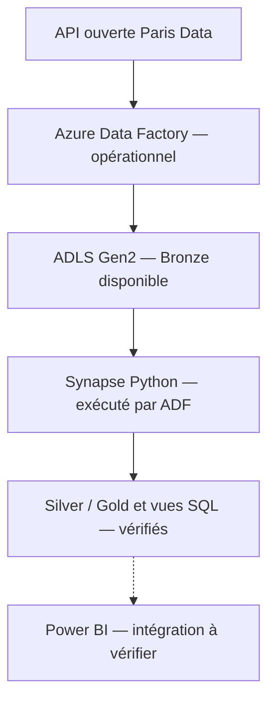

# Vélib Data Platform — Azure

Projet SUPINFO **5CLOU** · Équipe : **Chifa Chouchane, Cyrine Chammem et Nidhal Derbali**.

Une plateforme destinée à collecter les disponibilités Vélib depuis une API ouverte, conserver leur historique dans Azure, transformer les données avec **Python dans Azure Synapse Analytics**, puis présenter les résultats dans **Power BI**.

> **État au 2 novembre 2026 :** ingestion et raccordement **ADF → Synapse testés avec succès dans Azure**. Un même `batch_id` relie la collecte Bronze aux fichiers Silver et Gold. Les deux vues SQL lisent le batch vérifié. La livraison GitHub/publication ADF des derniers changements, la sélection automatique du dernier batch réussi et l’actualisation Power BI restent à finaliser ou vérifier. La plateforme complète n’est pas encore déclarée livrée.

**Portée de ce suivi :** les résultats du 2 novembre proviennent des exécutions et vérifications dans Azure. Ils ne prouvent pas que chaque modification est déjà fusionnée dans `main`. Les fichiers présents dans le dépôt doivent être rapprochés des versions réellement exécutées.

## Avancement selon l’énoncé

**Fonctionnel** : testé dans Azure sur le périmètre indiqué. **Partiel** : finalisation ou livraison restante. **Non vérifié** : aucun résultat confirmé pendant cette validation ; cela ne préjuge pas des travaux parallèles des équipiers.

| Exigence | État vérifié | Responsable | Pour terminer |
|---|---|---|---|
| Source ouverte | Fonctionnel : API Vélib Paris Data | Chifa | Compléter les conditions de réutilisation et la documentation de fraîcheur |
| Ingestion Data Factory — 6 points | Fonctionnel : collecte, manifeste et appel Synapse avec le même batch | Chifa | Livrer les derniers changements, tester les échecs et revalider la programmation complète |
| Traitement Synapse/Python — 6 points | Fonctionnel sur le batch vérifié : Silver/Gold et lecture SQL | Cyrine ; intégration avec Chifa, infrastructure avec Nidhal | Consolider les règles qualité, la reprise, la sélection du dernier batch réussi et le versionnement |
| Visualisation Power BI — 4 points | Non vérifié dans cette validation | Nidhal ; données avec Cyrine | Vérifier modèle, mesures, interactions, partage et actualisation |
| Code et dépôt — 2 points | Partiel : séparation ADF/Terraform/docs, commits et PR | Tous ; coordination Chifa | Contrôles automatisés, documentation finale et revues |
| Bonus Terraform — 2 points | Partiel : base importée et migration du backend distant confirmée | Base Chifa ; suite Nidhal | Vérifier la couverture Synapse/RBAC/réseau, les composants BI automatisables et la reproductibilité |
| Introduction — 2 points ; aisance orale — 2 points | À préparer | Tous | Support et répétitions chronométrées |
| Questions/réponses — 6 points | À préparer | Tous | Maîtriser la chaîne et justifier les choix |
| ZIP et démonstration Azure | À préparer | Tous ; coordination Chifa | Version finale, archive et démonstration complète |

Les points reprennent le barème fourni ; aucune note n’est considérée comme acquise.

## Architecture



Les liens en pointillés représentent les intégrations restantes.

**Périmètre :** l’implémentation actuelle utilise Azure Data Factory, ADLS Gen2 et le fournisseur Terraform `hashicorp/azurerm`. Azure Synapse Analytics est maintenant utilisé pour le traitement ; Power BI reste à valider pour la visualisation, conformément aux étapes Azure détaillées dans l’énoncé. Celui-ci emploie aussi le nom Microsoft Fabric : aucun workspace Fabric ni stockage OneLake n’est présenté ici comme déjà déployé. Cette distinction doit être explicitée lors de la présentation du périmètre retenu.

**Temporalité :** collecte par lots ; une programmation toutes les **10 minutes** a été testée le 28 octobre, avec environ **5 minutes** par collecte Bronze. La fenêtre de ce déclencheur est expirée. Le test ADF → Synapse du 2 novembre est manuel en mode Déboguer ; il ne prouve pas une programmation complète active. Il ne s’agit pas d’un flux événementiel continu. La latence jusqu’au dashboard dépendra également du traitement et de l’actualisation BI, encore non mesurés. La date source `duedate` diffère de la date de collecte ; une collecte paginée ne constitue pas un instantané atomique.

## Équipe : contributions et responsabilités

### Chifa — ingestion, coordination et première base Terraform

**Réalisé et vérifié :**

- Choix de la source Vélib et analyse des réponses JSON.
- Création du groupe de ressources, du stockage ADLS Gen2 et de Data Factory.
- Configuration des services liés REST/ADLS et de l’identité managée ADF pour le stockage.
- Datasets paramétrés, pipeline de test et pipeline paginé principal.
- Historisation par lot, contrôle du total annoncé, nouvelles tentatives et manifeste de fin de copie.
- Intégration GitHub, fusion de l’ingestion dans `main` et publication Azure.
- Programmation toutes les 10 minutes : quatre exécutions réussies figurent dans l’export de supervision.
- Contrôle hors pipeline d’un ZIP de 16 pages, contenant 1 520 stations distinctes.
- Guide d’ingestion, captures et export CSV présents dans le dépôt.
- Base Terraform : cinq ressources existantes importées, validation réussie et plan `No changes`.
- Intégration du code Terraform et de son guide dans `main`.
- Préparation des attributions Azure pour l’équipe et configuration des accès nécessaires à l’appel ADF → Synapse.
- Service lié Synapse `ls_synapse_velib_artifacts`, identité managée et test de connexion réussi.
- Activité `run_silver_gold` après `write_collection_manifest`, paramètre `batch_id = @pipeline().RunId`.
- Raccordement validé sur le batch `d241872a-3793-4c16-87ee-c1afcfec2921` : pipeline et notebook réussis, fichiers Silver/Gold et vues SQL vérifiés.
- Corrections d’intégration réalisées dans le notebook : utilisation du paramètre reçu et remplacement des assertions sur un nombre fixe de vélos par des contrôles de cohérence.
- Migration de l’état Terraform vers le backend distant partagée avec Nidhal ; couverture des ressources supplémentaires à vérifier.

**À terminer :**

1. Tester et documenter le chemin d’échec contrôlé et les nouvelles tentatives réseau.
2. Finaliser la livraison des changements ADF de la branche `feature/adf-synapse-orchestration` : vérifier sauvegarde, PR, revue, fusion et publication. Avec Cyrine, vérifier le contrat de validation du lot avant publication des sorties.
3. Compléter les preuves et les contrôles du dépôt ; contribuer aux revues.
4. Coordonner l’intégration finale, le ZIP et le scénario de démonstration.

L’ingestion et son raccordement au traitement sont testés dans Azure. Les tests d’échec, la documentation et la livraison des derniers changements restent à terminer.

### Cyrine — traitement Synapse/Python et qualité des données

**État au 2 novembre :** notebook `velib_synapse`, sorties Silver/Gold et vues SQL exécutés et vérifiés dans Azure. Cyrine conserve la responsabilité du traitement, des règles qualité et de leur versionnement. La liste ci-dessous décrit son périmètre ; chaque élément doit être confirmé par le code et les preuves, même si les sorties principales sont déjà produites.

1. Définir avec Nidhal le stockage et les accès nécessaires à Synapse.
2. Lire un lot à partir du manifeste et extraire `results` de chaque page JSON.
3. Contrôler les pages, le total de lignes, l’unicité des codes et les champs ; écrire un rapport de validation.
4. Garder `stationcode` et les codes géographiques comme chaînes ; typer compteurs, coordonnées, indicateurs et dates UTC.
5. Définir le traitement des données anciennes ou incohérentes : signalement ou rejet documenté, sans correction arbitraire de la source.
6. Produire **Silver** : données nettoyées et historisées avec `batch_id`, date de collecte et date source.
7. Consolider **Gold** : les agrégats globaux et par commune sont vérifiés ; les indicateurs par station/période et la sélection automatique du dernier état restent à confirmer selon les livrables retenus.
8. Préparer avec Nidhal les tables/vues pour Power BI et vérifier leur lecture selon le format retenu.
9. Garantir la reprise d’un lot sans doublons et rendre les traitements paramétrables.
10. Reprendre dans GitHub les corrections réalisées pendant l’intégration, versionner le code/notebook publié, les règles et les preuves ; présenter les transformations à l’oral. Documenter notamment les données anciennes et écarts de capacité observés.

**Livrables :** Python/PySpark, notebooks Synapse, règles qualité, résultats de validation, schémas Silver/Gold, scripts SQL si retenus, dictionnaire des données et tests pertinents.

### Nidhal — infrastructure complémentaire, Terraform et Power BI

**État au 2 novembre :** workspace `syn-velib-data-platform-2026` et pool `sparkvelib` opérationnels dans Azure ; backend Terraform distant migré. La couverture Terraform finale et Power BI ne sont pas vérifiés ici. Nidhal conserve la responsabilité de l’infrastructure complémentaire, de Terraform et de Power BI.

1. Avec Chifa, maintenir le backend Terraform distant partagé et coordonner les imports/applications pour éviter des modifications concurrentes.
2. Vérifier que le workspace Synapse, le stockage, le pool Spark, les accès et les paramètres réseau effectivement utilisés sont couverts par Terraform ou documentés comme manuels.
3. Préparer avec Chifa les attributions que son rôle Contributeur ne permet pas de créer lui-même.
4. Documenter les coûts, l’arrêt automatique du calcul et les limites de l’abonnement étudiant.
5. Avec Cyrine, connecter Power BI aux données traitées et définir le modèle analytique.
6. Construire les mesures, filtres et pages ; faire ressortir les stations critiques et la fraîcheur des données.
7. Vérifier le mode de connexion, les licences/capacités, le partage et la cadence d’actualisation disponibles.
8. Étendre Terraform aux composants BI pris en charge et documenter les opérations restant manuelles.
9. Tester la reproductibilité et versionner les livrables BI et leur documentation.
10. Préparer les preuves du dashboard et présenter les choix d’infrastructure et de visualisation.

**Livrables :** extension Terraform, procédure de reprise, infrastructure Synapse, suivi des coûts, rapport/projet Power BI, modèle et mesures documentés, preuve d’actualisation et guide de démonstration.

### Travail commun

Revue des pull requests, validation des contrats de données, test de bout en bout, présentation et questions/réponses. Chaque membre doit pouvoir expliquer toute l’architecture, au-delà de sa partie.

## Ingestion et contrat des données

### Source et ressources

- Dataset : [Vélib — disponibilité en temps réel, Paris Data](https://opendata.paris.fr/explore/dataset/velib-disponibilite-en-temps-reel/).
- [Endpoint REST utilisé](https://opendata.paris.fr/api/explore/v2.1/catalog/datasets/velib-disponibilite-en-temps-reel/records?limit=100&order_by=stationcode&offset=0).
- API publique sans authentification ; enveloppe JSON `total_count` et `results`.
- Conditions de réutilisation, attribution et limites d’usage : à consigner dans la documentation finale de la source.

| Ressource | Nom |
|---|---|
| Abonnement / région | Azure for Students / France Central |
| Groupe de ressources | `rg-velib-data-platform` |
| Compte ADLS Gen2 | `stvelibchifa2026` |
| Conteneur | `velib-data` |
| Data Factory | `adf-velib-chifa-2026` |
| Pipeline principal / test initial | `pl_ingest_velib` / `pl_ingest_velib_test` |
| Déclencheur | `tr_velib_every_10_minutes` — fenêtre historique expirée |
| Workspace Synapse | `syn-velib-data-platform-2026` |
| Pool Spark / notebook | `sparkvelib` / `velib_synapse` |
| Service lié ADF → Synapse | `ls_synapse_velib_artifacts` |
| Base SQL serverless | `velib_analytics` |

### Pipeline principal

| Ordre | Activité | Fonction |
|---|---|---|
| 1 | `get_station_count` | Lire le nombre de stations annoncé |
| 2 | `check_station_count` | Accepter un total entre 1 et 9 900 ; sinon `INVALID_STATION_COUNT` |
| 3 | `for_each_page` | Calculer les offsets et parcourir les pages séquentiellement |
| 4 | `copy_velib_page_to_bronze` | Conserver chaque réponse avec son enveloppe JSON |
| 5 | `write_collection_manifest` | Écrire le manifeste après la réussite de la boucle |
| 6 | `run_silver_gold` | Exécuter `velib_synapse` sur `sparkvelib` après le manifeste ; transmettre `batch_id = @pipeline().RunId` |

Pagination : `limit=100`, `order_by=stationcode`, `offset` paramétré et une requête par copie (`MaxRequestNumber=1`). Les activités de collecte disposent de trois nouvelles tentatives espacées de 30 secondes. La concurrence du pipeline est limitée à 1.

Les paramètres calcul optionnels de l’activité notebook sont laissés non renseignés ; l’exécution vérifiée utilise la configuration du notebook/pool. L’appel utilise l’identité managée ADF. Le notebook possède une cellule de paramètres `batch_id = ""`, puis construit `BATCH_ID` depuis la valeur reçue, sans identifiant de lot codé en dur.

Les en-têtes de `get_station_count` utilisés lors de la réussite sont `Accept: application/json` et `Accept-Encoding: identity`, avec `limit=1`. Des essais précédents recevaient un corps gzip illisible dans `output.Response`, empêchant l’accès à `output.total_count` ; conserver et vérifier la configuration fonctionnelle.

### Stockage et reprise

```text
velib-data/bronze/velib/batch_id=<RunId>/manifest.json
velib-data/bronze/velib/batch_id=<RunId>/pages/page_0000.json
velib-data/bronze/velib/batch_id=<RunId>/pages/page_0001.json
...
velib-data/silver/velib/batch_id=<RunId>/*.parquet
velib-data/gold/velib/global/batch_id=<RunId>/*.parquet
velib-data/gold/velib/communes/batch_id=<RunId>/*.parquet
```

Le manifeste fournit le lot, le chemin des pages, les nombres attendus de stations/pages et sa date d’écriture UTC.

- `collection_status=copy_completed` indique la réussite des copies.
- Le manifeste de collecte utilise `validation_status=pending` : il ne constitue pas à lui seul un certificat de qualité. Les contrôles du notebook et leur rapport doivent être examinés avec Cyrine pour établir précisément les garanties de complétude.
- Un dossier sans manifeste de copie réussie ne doit pas être consommé comme un lot complet.
- Le contrôle du lot doit précéder la publication des données traitées ; vérifier avec Cyrine son ordre d’exécution, son rapport de sortie et le comportement en cas d’échec. La présence d’un fichier `_SUCCESS` ne remplace pas une validation métier du lot.

Guide détaillé : [docs/ingestion.md](docs/ingestion.md).

## Vérifications et preuves

### Validation ADF → Synapse du 2 novembre 2026

| Élément vérifié | Résultat |
|---|---|
| Pipeline / mode | `pl_ingest_velib` / Déboguer |
| Identifiant de pipeline et batch | `d241872a-3793-4c16-87ee-c1afcfec2921` |
| État global | Opération réussie ; 21 entrées d’activité affichées |
| Notebook | `run_silver_gold` réussi ; durée affichée 2 min 31 s |
| Entrée du notebook | `batch_id` égal au RunId ADF |
| Silver | Fichier Snappy Parquet de 80,84 Kio et `_SUCCESS` observés |
| Gold global et communes | Parquet et `_SUCCESS` confirmés pour le même batch |
| Lecture SQL globale | 1 520 stations ; 18 909 vélos = 11 641 mécaniques + 7 268 électriques |
| Autres indicateurs globaux | 29 602 places disponibles ; 38 stations vides ; 30 pleines |
| Qualité signalée | 17 stations anciennes ; 817 écarts de capacité, selon les règles du notebook à documenter |
| Exemple commune : Paris | 997 stations ; 11 953 vélos = 7 840 mécaniques + 4 113 électriques |

**Vues SQL :** `dbo.vw_velib_gold_global` et `dbo.vw_velib_gold_communes`, dans `velib_analytics`, lisent actuellement le dossier du batch ci-dessus. Les anciens chemins fixes ont été remplacés manuellement par celui du batch vérifié. **La sélection du dernier batch réussi n’est pas encore automatique** : Cyrine doit la finaliser avant de revendiquer une actualisation complète jusqu’à Power BI. Ne pas choisir le dernier lot en triant les UUID.

**Corrections et limites observées :**

- Un premier test réussi utilisait encore un ancien `BATCH_ID` codé en dur dans le notebook. La configuration a été corrigée pour consommer le paramètre ADF, puis la présence du nouveau dossier a été vérifiée.
- Une exécution a échoué sur `assert total_bikes == 18792`. Ce nombre dépendait d’une ancienne collecte ; le contrôle a été remplacé par des vérifications de valeurs présentes/non négatives et de cohérence entre total, mécaniques et électriques. Conserver les autres contrôles et examiner l’ensemble avec Cyrine.
- Une session interactive et une session ADF ont coexisté ; l’appel ADF est resté en file d’attente. Après arrêt des sessions et une nouvelle tentative, le traitement a pu s’exécuter. La cause précise de l’attente n’est pas établie par les captures. Éviter de multiplier les lancements et tenir compte des limites du pool étudiant.
- Un échec tardif peut laisser des fichiers déjà écrits : sélectionner un batch validé exige un contrat explicite de réussite, et pas seulement l’existence d’un dossier.
- Les captures du 2 novembre ont été vérifiées pendant la séance ; leur ajout dans `docs/` et le rapprochement des versions Azure/GitHub restent à effectuer. Ne pas les présenter comme déjà versionnées.

### Collectes planifiées

L’[export de supervision](docs/ingestion-pipeline-runs.csv) contient quatre réussites le **28 octobre 2026**, aux heures affichées dans le portail en fuseau de Paris :

| Début | Fin | Durée | Résultat |
|---|---|---|---|
| 22:10:01 | 22:15:12 | 5 min 11 s | Réussite |
| 22:20:01 | 22:25:14 | 5 min 13 s | Réussite |
| 22:30:01 | 22:35:19 | 5 min 18 s | Réussite |
| 22:40:01 | 22:45:16 | 5 min 16 s | Réussite |

La configuration versionnée fixe la fin du test au **28 octobre 2026 à 23:10, fuseau de Paris**. Elle ne démontre pas une collecte permanente après cette échéance. Prévoir une nouvelle fenêtre publiée pour les prochains essais et la soutenance.

### Contrôle hors pipeline d’un lot téléchargé

| Contrôle | Résultat |
|---|---|
| JSON | 16 fichiers lisibles ; structure des champs cohérente |
| Répartition | 15 pages de 100 stations et une page de 20 |
| Lignes / total annoncé | 1 520 / 1 520 |
| Codes station | 1 520 distincts ; aucun doublon ni code manquant |
| Compteurs vérifiés | Entiers positifs ou nuls |
| Somme des vélos mécaniques et électriques | Égale au total disponible sur toutes les lignes |
| Coordonnées / dates | Coordonnées dans les plages valides ; dates interprétables |

Ce contrôle concerne le ZIP transmis pendant la mise en place. Il ne garantit pas chaque future collecte ni l’identité du lot avec un instantané de référence indépendant.

**Points qualité pour Silver :**

- 844 stations présentent un écart entre `capacity` et `numbikesavailable + numdocksavailable` : conserver la donnée brute et signaler l’écart.
- Certaines dates source remontent à 2017 ; la plus récente du ZIP est `2026-10-28T19:25:18Z`. Mesurer et afficher la fraîcheur.
- Une variation de stock ne permet pas de déduire un nombre exact de trajets : maintenance et rééquilibrage peuvent aussi intervenir.

### Captures présentes

| Preuve | Fichier |
|---|---|
| Pipeline | [Vue ADF](docs/ingestion-pipeline.png) |
| Réussite avec manifeste | [Exécution complète](docs/ingestion-run-with-manifest.png) |
| Fichiers Bronze | [Pages JSON](docs/ingestion-bronze-pages.png) |
| Programmation | [Paramètres du déclencheur](docs/ingestion-trigger-setting.png) |
| Supervision | [Exécutions planifiées](docs/ingestion-scheduled-runs.png) |
| Infrastructure | [Ressources Azure](docs/azure-resources.png) |

## Infrastructure Terraform — bonus partiel

La base initiale décrit cinq ressources : groupe de ressources, stockage, conteneur, Data Factory avec identité/GitHub et rôle d’écriture sur le conteneur.

Validation réalisée sur la machine de Chifa :

```text
terraform init      → initialisation réussie
terraform validate  → Success! The configuration is valid.
terraform import    → cinq ressources existantes importées
terraform plan      → No changes. Your infrastructure matches the configuration.
```

Le fournisseur verrouillé est **AzureRM 4.81.0**. Les ressources ont d’abord été créées dans le portail puis importées. Le déploiement complet dans un environnement vierge n’a pas encore été testé.

La couverture actuelle des ressources complémentaires et des objets ADF/Synapse doit être vérifiée avec Nidhal dans le code et le plan. La présence du workspace dans Azure ne prouve pas sa reproductibilité par Terraform. L’authentification GitHub d’ADF peut nécessiter une intervention dans Studio.

**Backend distant : migration confirmée**, conteneur `tfstate` du compte `stvelibchifa2026`, clé `velib.terraform.tfstate`, dans `rg-velib-data-platform`. L’authentification utilise Microsoft Entra ID/Azure CLI. Coordonner les imports et applications entre Chifa et Nidhal ; ne pas appliquer une configuration contre l’existant depuis un état vide. Ne jamais versionner l’état ni ses sauvegardes. Conserver `.terraform.lock.hcl` dans le dépôt.

Procédure : [infra/terraform/README.md](infra/terraform/README.md).

## Organisation du dépôt

### Structure initiale et chemins de référence

```text
README.md                       Présentation et suivi global
.gitignore                      Exclusions des états et fichiers locaux
docs/                           Guide, captures et export de supervision
ingestion/adf/
  dataset/                      Datasets REST et ADLS
  linkedService/                Connexions REST et ADLS
  pipeline/                     Pipeline principal et test initial
  trigger/                      Déclencheur planifié
  templates/                    Modèle ADF exporté
  publish_config.json           Configuration de publication
infra/terraform/                Infrastructure, verrouillage et guide
```

### Livrables complémentaires : présence et versions à rapprocher

| Dossier proposé | Contenu | Responsable |
|---|---|---|
| `processing/` | Python, notebooks et scripts SQL Synapse | Cyrine |
| `powerbi/` | Rapport/projet BI, mesures et modèle documenté | Nidhal |
| `tests/` | Contrôles de qualité et de reprise | Cyrine et Chifa |
| `.github/workflows/` | Validation automatisée | Chifa et Nidhal |
| `presentation/` | Support et scénario de démonstration | Tous |

Ces chemins servent à organiser les livrables. La présence et les versions finales doivent être vérifiées sur la branche puis sur `main` ; les versions exécutées dans Azure ne sont pas supposées automatiquement identiques aux fichiers GitHub.

## Prise en main et collaboration

### Code

```powershell
git clone https://github.com/chifa376/azure-realtime-data-platform.git
Set-Location azure-realtime-data-platform
git switch main
git pull --ff-only origin main
```

Pour une copie déjà présente, se placer dans son dossier et vérifier `git status` avant de changer de branche. Créer une branche depuis `main` à jour :

```powershell
git switch -c feature/synapse-processing
```

Branches de travail : `feature/adf-synapse-orchestration` pour le raccordement réalisé par Chifa ; `feature/synapse-processing` pour Cyrine ; `feature/terraform-synapse` et `feature/powerbi-dashboard` pour Nidhal. Adapter les noms aux branches réellement présentes. Utiliser des commits explicites et une PR relue vers `main`.

`adf_publish` contient les artefacts générés par ADF et reste distincte de `main`. Dans ADF, les changements suivent le workflow Git puis une publication pour atteindre l’environnement déployé.

### Accès et sécurité

- Les accès Azure de l’équipe sont à vérifier avec chacun selon ses opérations : gestion du groupe de ressources, lecture/écriture des données et rôles Synapse distincts. Les tests d’intégration de Chifa ne prouvent pas tous les accès individuels ni ceux de Power BI.
- Contributeur ne permet pas d’attribuer des rôles RBAC. Pour l’appel validé, l’identité managée ADF dispose des rôles Synapse Artifact User et Synapse Compute Operator ; les identités ADF et Synapse disposent des accès Blob nécessaires sur `velib-data`. Vérifier et documenter le partage Power BI séparément.
- L’accès en écriture au dépôt nécessite l’acceptation de l’invitation GitHub.
- L’ingestion utilise l’identité managée ADF ; l’écriture est limitée au conteneur.
- Conteneurs de données non publics, HTTPS et TLS 1.2 ; accès réseau public du stockage conservé. L’option d’accès des services/ressources Azure au workspace Synapse a été activée pendant l’intégration : la documenter avec les règles réseau, sans la confondre avec une autorisation RBAC.
- Ne pas publier mots de passe, jetons, clés, états Terraform ou plans contenant des valeurs sensibles.
- Dimensionner le calcul et les capacités BI selon l’abonnement ; documenter les coûts et l’arrêt automatique.

## Prochaines étapes et dépendances

| Ordre | Action restante | Responsable | Preuve attendue |
|---|---|---|---|
| 1 | Sauvegarder/revoir/fusionner les derniers changements ADF puis publier depuis la branche de collaboration | Chifa ; revue équipe | PR, commit identifié et test de la version publiée |
| 2 | Rapprocher le notebook publié et le code GitHub ; versionner les corrections d’intégration | Cyrine avec Chifa | Paramètre batch et contrôles dynamiques présents dans les sources livrées |
| 3 | Consolider qualité, rapport de validation et reprise ; exposer automatiquement le dernier batch réussi | Cyrine | Tests pertinents, règles documentées et vues sans chemin de batch figé |
| 4 | Vérifier Power BI, la connexion aux vues, le modèle, les interactions et l’actualisation | Nidhal avec Cyrine | Rapport et preuve d’actualisation sur les nouvelles données |
| 5 | Vérifier la couverture Terraform, les accès et le réseau ; documenter coûts et arrêt automatique | Nidhal avec Chifa | Plan relu, procédure de reprise et limites explicites |
| 6 | Tester le chemin d’échec contrôlé et les nouvelles tentatives ; compléter les preuves ADF | Chifa | Résultats et captures versionnés, configuration normale restaurée |
| 7 | Revalider une fenêtre de programmation sur la chaîne complète après publication | Chifa avec l’équipe | Exécutions déclenchées, même batch et fraîcheur jusqu’au rapport |
| 8 | Actualiser docs, finaliser le ZIP et répéter l’oral | Tous ; coordination Chifa | Archive issue de `main`, démonstration et oral chronométrés |

**Répartition conservée :** Chifa prend en charge ingestion/orchestration, livraison ADF, preuves et coordination ; Cyrine le traitement, la qualité et les vues SQL ; Nidhal l’infrastructure complémentaire, Terraform et Power BI. Les vérifications croisées ne transfèrent pas la responsabilité des livrables.

### Indicateurs envisagés

Vélos disponibles par type ; places disponibles ; stations sans vélo ou sans place et état de service ; disponibilités par commune ; évolution entre collectes ; taux de disponibilité avec définition explicite et gestion des capacités nulles ou égales à zéro ; anomalies qualité et âge des données source.

Les agrégats globaux et par commune ci-dessus sont vérifiés en SQL. Les visuels, mesures BI, analyses temporelles et fonctionnalités restantes doivent être confirmés dans les livrables Power BI.

## Livrables et soutenance

### Archive ZIP du dépôt

- [x] Définitions ADF et configuration Git.
- [x] Première base Terraform et guide de reprise.
- [x] Guide d’ingestion et premières preuves.
- [ ] Code/notebooks Python-Synapse : traitement vérifié dans Azure ; rapprochement des versions et livraison finale des contrôles à confirmer.
- [ ] Livrables Power BI et procédure d’actualisation.
- [ ] Automatisation complémentaire et procédure complète de déploiement.
- [ ] Tests d’échec/reprise, dictionnaire des données, limitations et coûts consolidés.
- [ ] Support de présentation et scénario de démonstration.
- [ ] Archive finale vérifiée depuis une version identifiée de `main`.

Le ZIP doit contenir les sources et ressources nécessaires à la revue, y compris les livrables BI retenus. Exclure secrets, états Terraform et dépendances locales. Vérifier que les éventuels fichiers Git LFS sont réellement inclus. Préparer la version finale après intégration des trois parties.

### Démonstration Azure à préparer

1. Présenter la source et ses dates de mise à jour.
2. Déclencher une collecte et suivre son exécution ADF.
3. Montrer le nouveau dossier Bronze et son manifeste.
4. Montrer la validation et le traitement Python dans Synapse.
5. Vérifier Silver/Gold et leur exposition à Power BI.
6. Montrer l’actualisation, les interactions et la fraîcheur du rapport.
7. Présenter la supervision, un échec testé et le plan Terraform.

Les étapes Bronze → Synapse → Silver/Gold → SQL ont été vérifiées sur le batch du 2 novembre. Power BI et son actualisation restent à vérifier. Mesurer les durées de démarrage Spark et d’actualisation avant de figer le scénario de 15 minutes ; ne pas supposer un temps de démarrage constant.

### Répartition proposée des 15 minutes

| Temps | Sujet | Intervenant |
|---|---|---|
| 0–2 min | Objectif, source et architecture | Chifa |
| 2–5 min | Ingestion, historique et supervision | Chifa |
| 5–9 min | Python, qualité et Synapse | Cyrine |
| 9–12 min | Power BI et actualisation | Nidhal |
| 12–14 min | Résultat de bout en bout, Terraform et coûts | Nidhal avec l’équipe |
| 14–15 min | Limites et perspectives | Tous |

Intégrer les démonstrations à ces séquences. Prévoir ensuite **5 minutes de questions/réponses** et un support de type PowerPoint.

Questions à préparer : choix des services, ingestion périodique/streaming, fraîcheur réelle, pagination, doublons, échecs, identité managée, droits, coûts, état Terraform, actualisation BI et limites de la source.

## Références

- [Énoncé SUPINFO — 5CLOU, My Data Platform](https://github.com/SUPINFO-Organization/5CLOU-Exam/tree/main/01-my-data-platform)
- [Guide d’ingestion](docs/ingestion.md)
- [Guide Terraform](infra/terraform/README.md)

Mettre à jour ce README à chaque livraison : une tâche passe à « terminée » après intégration de ses fichiers et vérification de son résultat.
