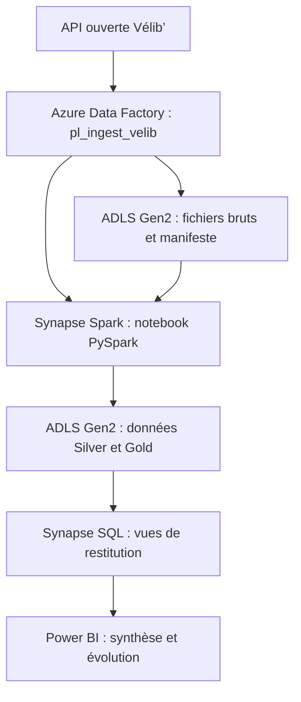

# Vélib’ — Plateforme de suivi de la disponibilité sur Azure

**Projet 5CLOU · SUPINFO · Chifa Chouchane, Cyrine Chammem et Nidhal Derbali**

Ce projet collecte les données ouvertes de Vélib’, les transforme sur Azure et les restitue dans un rapport Power BI. Il répond à trois questions : **combien de vélos sont disponibles, où se concentrent les stations vides ou pleines, et de quel lot proviennent les chiffres affichés ?**

La plateforme traite les données **par lots**. Chaque collecte reçoit un `batch_id` qui permet de relier l’exécution Azure Data Factory aux données stockées et aux résultats Synapse. Power BI interroge les vues SQL via DirectQuery pour les indicateurs suivis dans la démonstration.

## Architecture



| Composant | Rôle |
|---|---|
| **Azure Data Factory** | Orchestre la collecte paginée, écrit le manifeste et appelle le notebook Synapse. |
| **Azure Data Lake Storage Gen2** | Conserve les fichiers bruts, les données transformées et les marqueurs de publication par lot dans le conteneur `velib-data`. |
| **Synapse Spark / PySpark** | Transforme les données Silver et calcule les indicateurs Gold à l’échelle du réseau et par commune. |
| **Synapse SQL Built-in** | Lit les fichiers Gold et expose les données utiles à Power BI, notamment via `dbo.vw_velib_gold_communes_dynamic`. |
| **Power BI** | Présente deux pages : **Synthèse réseau** et **Évolution et tension**. |

## 1. Ingestion et traçabilité

Le pipeline `pl_ingest_velib` commence par récupérer puis lire le nombre d’enregistrements annoncé par la source. Après un contrôle sur cette valeur, il parcourt les pages de l’API, copie les données brutes et écrit un manifeste de collecte. Il lance ensuite l’activité notebook `run_silver_gold`.

Pour diagnostiquer une exécution, ouvrir **Surveiller → Exécutions de pipeline** dans Azure Data Factory, puis sélectionner l’exécution recherchée. Le détail par activité permet de distinguer un problème de collecte d’un problème de traitement Spark. Utiliser l’ID d’exécution pour suivre le lot associé.

Exemples de chemins en production, relatifs au conteneur `velib-data` :

| Chemin | Contenu |
|---|---|
| `gold/velib/communes/batch_id=<batch_id>/` | Agrégats Gold par commune au format Parquet. |
| `gold/velib/publications/batch_id=<batch_id>/` | Données de publication associées au lot. |

## 2. Traitements et règles de calcul

La couche **Bronze** conserve la collecte brute. La couche **Silver** prépare les données au niveau station. La couche **Gold** calcule les indicateurs pour le réseau et pour chaque commune, notamment les vélos disponibles, les places libres et les stations vides ou pleines.

Dans **Gold Communes** :

- **Station vide** : station opérationnelle dont les données ne sont pas périmées, avec zéro vélo disponible.
- **Station pleine** : station opérationnelle dont les données ne sont pas périmées, avec zéro place libre.
- `empty_stations` et `full_stations` comptent les stations qui satisfont ces règles pour chaque commune et chaque lot.

Les agrégations PySpark ont été mises à jour dans le package `velib-data-platform` **0.1.3**. Le test `tests/test_gold_communes.py` vérifie le comptage avec des stations vides, pleines, non opérationnelles et périmées.

```bash
python -m pytest tests/test_gold_communes.py -q
```

La lecture SQL des anciens et nouveaux fichiers Parquet a été testée avec un **schéma explicite**. Sur les anciens lots, les deux champs absents restent à `NULL` : cela signifie « indicateur non calculé ». Sur les nouveaux lots, `0` signifie que l’indicateur a été calculé et qu’aucune station ne remplit la condition.

## 3. Vérification de bout en bout

Le 16 novembre 2026, le pipeline de production `pl_ingest_velib` a été lancé manuellement. L’exécution a réussi en **10 min 55 s**. Le lot `a46d0c1d-97c9-46fc-b438-b468713d0569` a ensuite été contrôlé dans Synapse SQL.

| Indicateur | Avant dans Power BI | Après dans Power BI | Nouveau lot dans Synapse SQL |
|---|---:|---:|---:|
| Vélos disponibles | 18 824 | **19 201** | **19 201** |
| Stations vides | 99 | **81** | **81** |
| Stations pleines | 60 | 60 | 60 |
| Total des stations | 1 525 | 1 525 | 1 525 |

Le nouveau lot couvre **69 communes**. Le rapport est passé aux nouvelles valeurs sans cliquer sur **Actualiser**. Ce test démontre l’actualisation automatique du rapport à la suite d’une collecte lancée manuellement. L’intervalle configuré pour le rafraîchissement du rapport ne correspond pas à la durée totale de collecte et de traitement.

### Reproduire le contrôle dans Synapse SQL

Exécuter cette requête dans **SQL Built-in**, sur la base `velib_analytics`. Pour contrôler un autre lot, remplacer la valeur de `batch_id` par celle de l’exécution à vérifier.

```sql
SELECT
    batch_id,
    COUNT(*) AS communes,
    SUM(total_stations) AS stations,
    SUM(total_bikes) AS velos_disponibles,
    SUM(empty_stations) AS stations_vides,
    SUM(full_stations) AS stations_pleines
FROM dbo.vw_velib_gold_communes_dynamic
WHERE batch_id = 'a46d0c1d-97c9-46fc-b438-b468713d0569'
GROUP BY batch_id;
```

## 4. Démonstration sur Azure

1. **Azure Data Factory** : montrer le pipeline publié, lancer une collecte et suivre les activités dans la vue de supervision.
2. **Azure Storage et Synapse** : retrouver le lot à partir de son ID, montrer le traitement PySpark et exécuter la requête de vérification SQL.
3. **Power BI** : laisser la page ouverte, observer son actualisation et comparer les chiffres avec les résultats SQL. Utiliser ensuite les visuels du rapport pour expliquer l’état du réseau.

Les captures de l’exécution ADF, du résultat SQL et des vues Power BI avant/après documentent le même test. Elles servent de secours si une exécution en direct dépasse le temps de présentation.

## Contributions

| Membre | Contribution |
|---|---|
| **Chifa** | Ingestion et orchestration dans Azure Data Factory, stockage Azure et suivi des exécutions de production. |
| **Cyrine** | Transformations PySpark, calcul des indicateurs Gold par commune, tests et validation des vues Synapse SQL. |
| **Nidhal** | Conception des deux pages Power BI, intégration des indicateurs et validation de l’actualisation automatique. |
